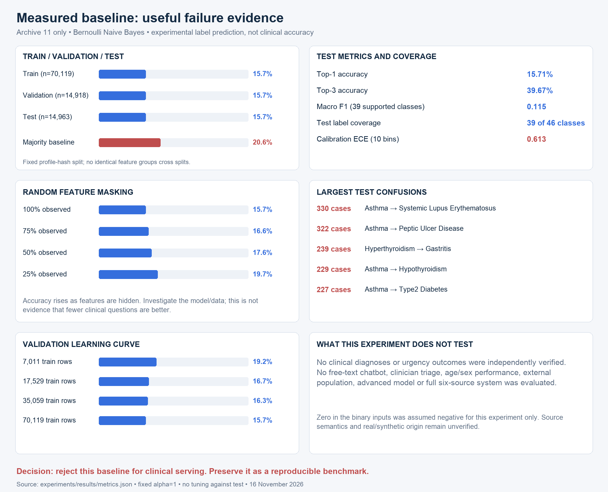
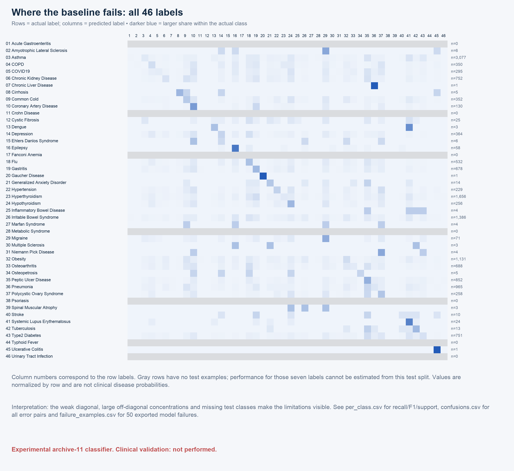
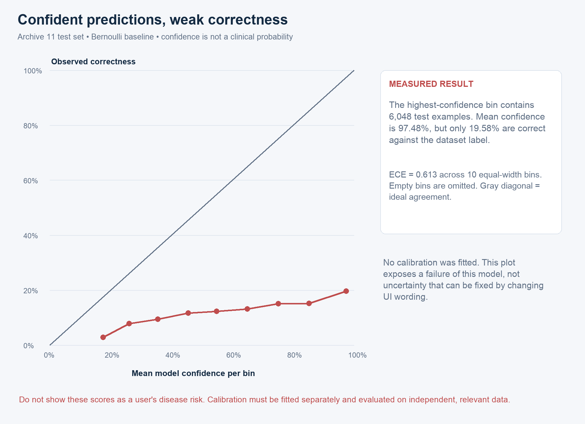

# Measured dataset audit and baseline experiment

These are computed results from the supplied archives. They evaluate an experimental classifier against dataset labels, not a person's real diagnosis or an end-to-end medical chatbot. No advanced model or clinical validation is claimed.

## Source audit

| File | Rows | Exact unique rows | Exact repeated rows |
|---|---:|---:|---:|
| Archive 11 diagnostic CSV | 100,000 | 100,000 | 0 |
| Archive 12 data.csv | 246,945 | 189,640 | 57,305 |
| Archive 12 final_symptoms_to_disease.csv | 192,715 | 163,727 | 28,988 |
| Archive 13 diseases_main.csv | 85 | 85 | 0 |
| Archive 13 causes.csv | 714 | 714 | 0 |
| Archive 13 symptoms.csv | 712 | 712 | 0 |
| Archive 13 treatments.csv | 621 | 621 | 0 |
| Archive 14 Healthcare.csv | 25,000 | 25,000 | 0 |
| Archive 15 train.csv | 475,502 | 475,502 | 0 |
| Archive 15 test.csv | 134,529 | 134,529 | 0 |
| Archive 16 descriptions CSV | 820 | 820 | 0 |
| Archive 16 symptom matrix | 190,672 | 190,672 | 0 |

Exact uniqueness compares parsed cell values across the whole row, including patient IDs when present. It is different from repeated profiles after excluding IDs. Archive 15 has 71,934 repeated train rows and 8,032 repeated test rows under the latter definition, with **27,622 distinct profile signatures shared between files**. Those signatures still include age, sex, disease and feature values. Label-excluding and semantic near-duplicate audits could find additional overlap. Do not infer repeated real humans from this result.

All 37 repeated header names in archive 16 have disagreements somewhere. Examples: vomiting 22,272 conflicting rows; cough 19,052; headache 18,996; nausea 18,946; back pain 18,588; fever 16,829. A single row can contribute to several feature conflicts, so these counts cannot be summed as unique bad rows. Keep each column position and send reconciliation to review.

The crosswalk has 960 lexical disease groups and 1,651 positional feature mappings across the matrix files. The latter collapse to 958 candidate lexical feature IDs, but these include questionnaire/history/risk concepts and are not 958 verified symptoms. This positional count excludes concepts that still need extraction from narrative/list fields.

## Fixed experimental protocol

- Data: archive 11 only, 100,000 unique labelled rows, 174 binary feature columns, 46 source labels.
- Model: Bernoulli Naive Bayes, fixed Laplace smoothing alpha 1, add-one smoothed empirical training class priors. The script implements the formula in NumPy.
- For this experiment only, a binary zero is interpreted as a negative feature. Source documentation has not established that interpretation for clinical use.
- Split: hash the feature vector with SHA-256, take the first eight hex digits modulo 100; values below 70 train, 70–84 validation, 85–99 test. Labels do not enter the split hash. Identical feature vectors stay together.
- There are 100,000 feature groups and no identical feature-group overlap across splits. This does not establish absence of related patients, synthetic templates or near duplicates.
- No model selection or tuning used the test results. The reported test set is now exposed; future iterative model development needs a fresh untouched test for final claims.

## Measured performance

| Metric | Train | Validation | Test |
|---|---:|---:|---:|
| Rows | 70,119 | 14,918 | 14,963 |
| Labels represented | 46 | 41 | 39 |
| Top-1 accuracy | 15.65% | 15.70% | 15.71% |
| Top-3 accuracy | 39.89% | 39.50% | 39.67% |
| Macro F1 on labels with support | 0.107 | 0.086 | 0.115 |
| Balanced accuracy on labels with support | 0.302 | 0.185 | 0.251 |
| Expected calibration error, 10 bins | 0.615 | 0.617 | 0.613 |

Test majority-class baseline is **20.56%**; it always predicts the most frequent class in training. Thus this experimental model fails to beat the simple comparator. Test multiclass Brier score is 1.378 and negative log likelihood is 7.385. Confidence values are severely overconfident and cannot be presented as clinical probabilities.

Seven labels have no test examples. Several have only one or a few. Macro F1 here averages only the 39 test-supported labels; this is explicit and must not be presented as a full 46-condition validation. No confidence intervals are included in this exploratory run. A release benchmark requires uncertainty estimates and adequate per-class support.

## Where it fails

| Actual dataset label | Predicted label | Test errors |
|---|---|---:|
| Asthma | Systemic Lupus Erythematosus | 330 |
| Asthma | Peptic Ulcer Disease | 322 |
| Hyperthyroidism | Gastritis | 239 |
| Asthma | Hypothyroidism | 229 |
| Asthma | Type2 Diabetes | 227 |

These are classifier confusions against source labels, not adjudicated clinical mistakes. `per_class.csv` gives support, recall and F1 for every class; `confusions.csv` contains all nonzero error pairs; `failure_examples.csv` contains the first 50 incorrect held-out examples in deterministic sorted-row order. The examples are not a random failure sample and no clinical reviewer has assessed them.

## Missingness and learning findings

| Fraction of feature entries observed | Test accuracy |
|---|---:|
| 100% | 15.71% |
| 75% | 16.58% |
| 50% | 17.60% |
| 25% | 19.66% |

The mask randomly hides both positive and negative entries. Hidden values make no likelihood contribution. This is a robustness probe, not a realistic conversation simulator. Rising accuracy as features are hidden is a reason to investigate the data semantics, dependency assumptions and class priors. It is not evidence that fewer clinical questions improve care.

Validation accuracy at 7,011 / 17,529 / 35,059 / 70,119 training rows is 19.23% / 16.70% / 16.34% / 15.70%. Smaller subsets are sampled once with a fixed RNG seed. They are not repeated trials or a tuned learning-curve study. The direction is another failure signal, not proof of a particular cause.

## Decision and next experiments

**Reject this baseline for clinical serving.** Preserve it as a reproducible comparison. This result does not establish that the overall product is impossible; it establishes that this model/data interpretation is inadequate.

Next: verify zero semantics and label origins; inspect feature relationships and possible source artifacts; run a regularized linear baseline and a boosted challenger on controlled splits; evaluate missingness explicitly; create a separately adjudicated external case set; calibrate and test abstention using dedicated partitions. Investigate error families before increasing model complexity.

Currently unavailable: age/sex performance for archive 11; urgency/under-triage scores; live dialogue accuracy; RAG citation support; external population performance; advanced-model results; clinical outcomes. The source files do not supply the necessary verified labels for these evaluations. Their future plots must not be filled with invented numbers.
