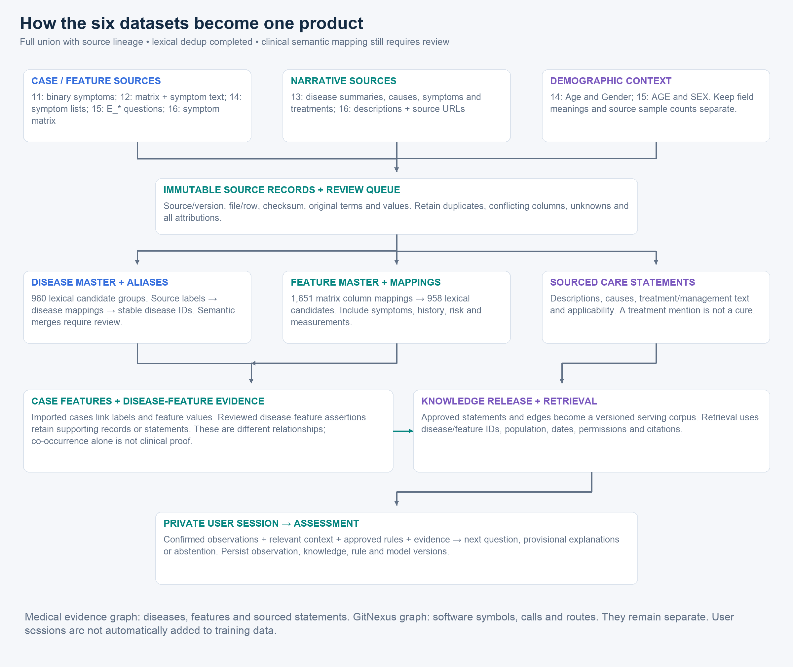
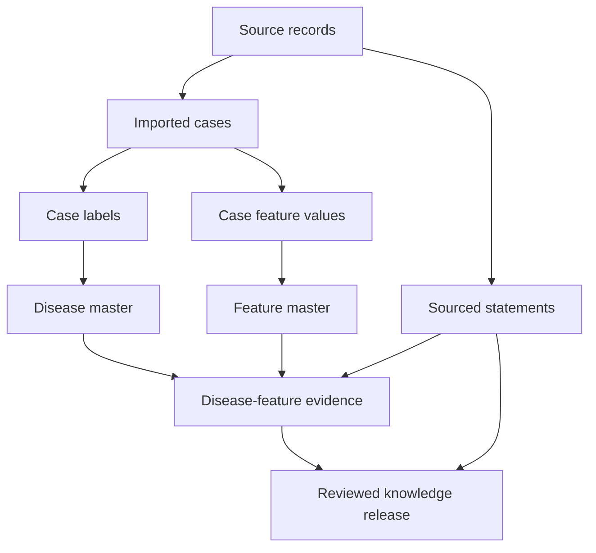

# Combined data design and source-to-target mapping

The combined product dataset is a set of related, versioned tables. A wide flat CSV loses narrative provenance, duplicate-column conflicts, different source populations and the distinction between an unasked feature and an explicit negative. Export task-specific Parquet views from the relational source of truth after review.

## Source fields and exact target mapping

| Archive / source field | Target | Transformation / meaning |
|---|---|---|
| All ZIPs and CSV/text files | sources, source_records | Source version + content hash + file path + row/text locator; retain the original byte object |
| 11 `disease` | disease_mappings → diseases; case_labels | Case/whitespace lexical candidate only |
| 11 `symptom_*`, `rare_symptom_*` | feature_mappings → features; case_features | Preserve column position; prefix removal produces a review candidate, not an approved equivalence |
| 12 data.csv `diseases` | disease_mappings; case_labels | Same lexical disease policy |
| 12 data.csv other 377 columns | feature_mappings; case_features | Positional binary attributes; zero semantics unresolved |
| 12 final_symptoms_to_disease.csv `diseases`, `symptom_text` | case_labels; source_records; parsed case_features | Separate representation; parse symptom text into candidates; do not align row numbers to data.csv |
| 13 diseases_main.csv `id`, `name` | disease_mappings.original_id/original_label | Native ID scoped to archive/source version |
| 13 `category` | source record metadata / review queue | Preserve original; do not trust as an approved taxonomy |
| 13 `summary` | statements(description) | Pending review, linked to original row and URL |
| 13 `word_count`, `url` | raw metadata; statement_sources.source_url | Word count is a source attribute, not an evidence score |
| 13 causes.csv `disease_id`, `disease_name`, `cause` | statements(cause); statement_sources | Join ID to diseases_main.id; verify redundant name agrees |
| 13 symptoms.csv `disease_id`, `disease_name`, `symptom` | statements(symptom); proposed disease_feature_evidence | Narrative claim first; extract atomic feature relations into review queue |
| 13 treatments.csv `disease_id`, `disease_name`, `treatment` | statements(treatment) | Do not turn mention into cure, prescription or patient eligibility |
| 13 text files | source_records; statements/evidence_chunks after review | Preserve text, URL, extraction version, character offsets and attribution |
| 14 `Patient_ID` | dataset_cases.source_patient_id | Namespace to source; not a global patient identity |
| 14 `Age` | dataset_cases.age_value/age_unit | Preserve numeric value; confirm unit from source documentation before clinical use |
| 14 `Gender` | original_demographic_field/value | Preserve Male/Female/Other; do not reinterpret as birth sex |
| 14 `Symptoms` | raw record; parsed case_features | Parse list/text safely; normalize terms into pending mappings |
| 14 `Symptom_Count` | raw record + data-quality comparison | Derived count, not a diagnosis predictor by default |
| 14 `Disease` | disease_mappings; case_labels | Same lexical policy |
| 15 `PATIENT_ID`, `AGE`, `SEX`, `DISEASE` | dataset_cases; disease_mappings; case_labels | Retain split and source namespaces; M/F meaning remains source-defined |
| 15 `E_*` (223 positions) | feature_mappings; case_features | Preserve full question text and raw value; classify symptom/history/risk/measurement/other |
| 15 `SYMPTOM_COUNT` | raw record + consistency check | Do not treat all E_* questions as symptoms or the count as ground truth |
| 16 matrix `diseases` | disease_mappings; case_labels | Same lexical policy |
| 16 matrix other 654 positions | feature_mappings; case_features | Duplicate headings remain separate mappings and conflicting values remain explicit |
| 16 descriptions `Disease`, `Description` | disease_mappings; statements(description) | Filename containing “verified” is not independent clinical validation |
| 16 `Source`, `Source_URL`, `Retrieved_Date`, `Canonical_Query` | source provenance / statement attribution / chunk metadata | Retain supplied values; retrieval date does not establish medical currency |

## Entity relationships and join keys

| Relationship | Cardinality | Implementation |
|---|---|---|
| Source → source record | 1:N | source_records.source_id |
| Disease → source aliases | 1:N | disease_mappings.disease_id, scoped by mapping release |
| Feature → positional/list term mappings | 1:N | feature_mappings.feature_id; duplicate column positions remain distinct |
| Source record → imported case | 1:0..1 | dataset_cases.record_id unique |
| Imported case ↔ disease | M:N | case_labels; preserves ambiguous labels |
| Imported case ↔ feature | M:N | case_features through feature_mappings |
| Disease ↔ feature evidence | M:N | disease_feature_evidence, with source record or statement provenance |
| Disease → narrative statements | 1:N | statements.disease_id and statement_type |
| Statement ↔ source record | M:N | statement_sources, retaining all attributions after deduplication |
| Knowledge release → evidence chunks | 1:N | evidence_chunks.knowledge_release_id |
| User session → observations/answers/assessments | 1:N | session_id plus observation_version; separate from dataset_cases |
| Assessment → model/rules/knowledge releases | N:1 each | Immutable release IDs and prompt/provider versions |

## Deduplication output and its limits

`disease_mappings.csv` contains archive, file, raw label, normalized label, candidate ID and mapping status. One disease candidate may appear in many source-file rows. Candidate IDs are deterministic hashes of the normalized lexical term; assign stable approved entity IDs and redirects during semantic review.

`feature_column_mappings.csv` contains archive, file, zero-based column index, original heading, candidate term, candidate ID and status. An index refers to the original CSV, including the disease column. Narrative/list-field terms are not yet in this positional crosswalk. They must be extracted separately and reviewed.

`disease_candidate_catalog.csv` contains one row for each of the 960 lexical disease candidates, with original terms and source-file membership. `feature_candidate_catalog.csv` does the same for the 958 lexical feature candidates. Both are deduplicated candidate catalogs; neither is an approved clinical terminology.

For imported cases, preserve each original record and attach duplicate/profile cluster IDs. Build a training view that selects representatives or applies cluster weights after defining the experimental unit. Keep all cluster members in the same split. Do not delete evidence lineage or make raw counts look like unique patients.

The audit establishes exact duplicates and lexical overlap. It does not establish semantic disease equivalence, patient identity, clinical validity or final training eligibility. “960 disease groups” is a measured interim count; the final approved count can decrease through synonym merges or increase when ambiguous terms are split.

## Serving and ML exports

| Export / view | Contents | Eligibility |
|---|---|---|
| reviewed_disease_catalog | Disease IDs, names, aliases, definitions | Approved mapping release |
| reviewed_disease_feature_edges | Disease ID, feature ID, relation, context, evidence | Approved evidence and source use rights |
| reviewed_care_statements | Management/treatment/prevention descriptions and applicability | Clinician-reviewed source statements; never personalized prescriptions by default |
| model_cases | Source/case/cluster IDs, label origin, split | Explicitly eligible for the experiment |
| model_observations | Case ID, feature ID, observed mask, value/polarity, source mapping | Approved semantics; unknown is not false |
| retrieval_corpus | Chunk ID, parent text, source, concept IDs, population, dates, permissions | Approved knowledge release and current applicability |
| session_summary | Confirmed observations, relevant negatives, answers, unknowns, next step | Private, owner-scoped, current observation version |

No combined “male/female prevalence” export is approved from these rows. Exploratory source-stratified occurrence counts may be produced with denominators and unknowns, clearly identified as sample counts. Dataset composition, synthetic sampling and duplicates can dominate those proportions.

## Additional data needed

Reviewable clinical guidelines, a question dictionary, verified feature meanings, urgency labels, population-specific evaluation cases and clinically verified outcomes are needed for a reliable care-navigation release. Existing descriptions and treatment statements can seed a review workflow; they do not replace these inputs. Geography/seasonal incidence and medication interactions are later integrations only when their licensing, relevance and clinical scope are established.
