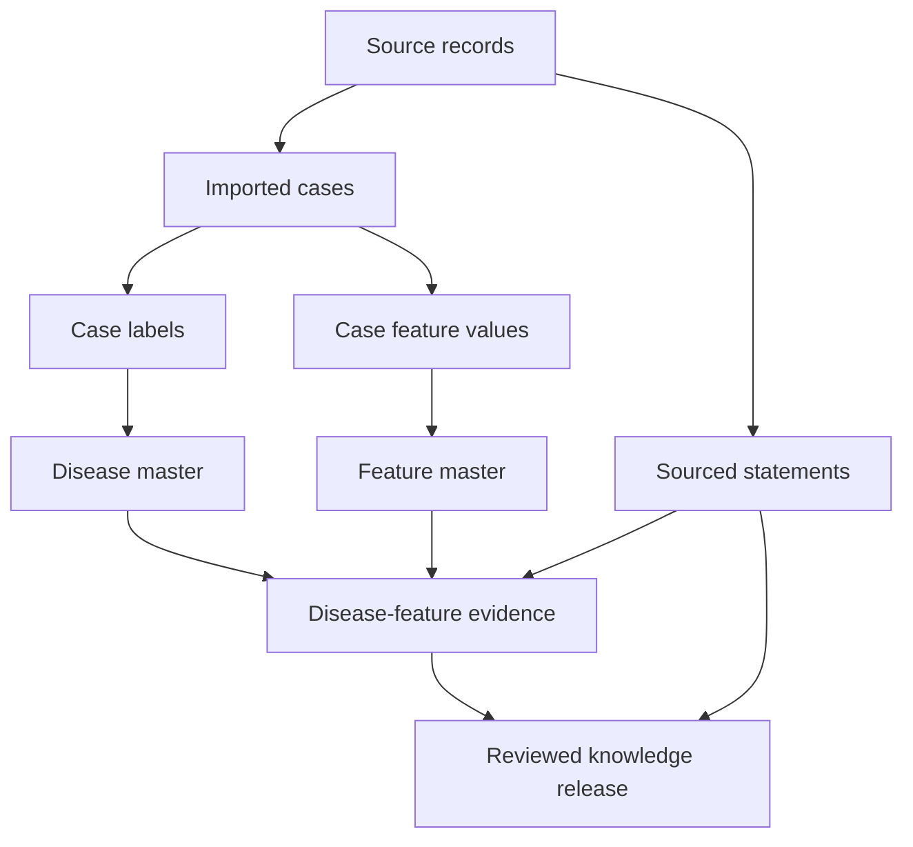

# Feeltriva — complete product, data, engineering and frontend handoff

Read README_START_HERE.md for package use and the Claude starting instruction. This file combines the reference documents for convenience; the individual docs contain the same specification. SQL, OpenAPI, mapping CSVs, experiment scripts and result files remain separate machine-readable artifacts.

---

# Feeltriva — product and engineering specification

Version 1.0 • 16 November 2026 • Implementation handoff for Claude

## 1. Name and product definition

**Feeltriva** (feel-TREE-vah). Working tagline: **Understand your symptoms. Know your next step.** This is a coined working name: exact-name searches in two search engines did not return an exact match during this task. This is not trademark, domain, app-store or company-name clearance. Complete those checks before adopting the brand publicly.

Feeltriva is a conversational symptom-assessment and care-navigation product. A person describes what they feel; the system extracts and confirms observations, asks relevant follow-up questions, checks urgency and provides provisional possible explanations with an appropriate next step. The application maintains an auditable assessment record. It does not establish a diagnosis, prescribe medication or promise a cure.

The problem: users describe symptoms informally, lack context on urgency, struggle to identify useful details, and receive fragmented or overconfident information from searches. Clinicians receive incomplete histories. The solution is structured questioning plus traceable evidence and explicit uncertainty, not a disease-name generator.

### Users and business model

- Primary hypothesis: adults in India seeking help understanding non-emergency symptoms; English text at first. Geography, language and age are proposed v1 scope decisions, not properties proven by the datasets.
- Secondary: clinicians reviewing a user-approved consultation summary. Caregiver/minor assessment is outside initial validated scope.
- Suggested rollout: internal evaluation → clinician-supervised pilot → controlled consumer release only after evidence and regulatory review.
- Business hypothesis: clinic intake SaaS and consumer longitudinal symptom tracking. Do not monetize emergency guidance or let commercial referrals alter candidate ranking or urgency.
- Differentiate through evidence-backed questions, continuity, correction handling, source traceability and a useful clinician handoff.

### Outcomes and measures

Measure: clinically appropriate next-step rate on adjudicated cases, under-triage and over-triage rates, useful-summary rate, completion without repetitive questions, correction rate, accessibility, latency and cost/session. Disease top-k recall is a secondary offline measure. Session duration or conversion alone must not override safety. No current clinically validated performance claim exists.

## 2. Functional specification

| ID | Capability | Required behaviour / acceptance criterion |
|---|---|---|
| FR01 | Consent and scope | Explain intended use and data handling; allow an assessment without a named account; identify unsupported age/scope without claiming the complaint is harmless. |
| FR02 | Free-text intake | Capture raw wording, normalize candidate features and preserve negation, time, uncertainty and who is experiencing the symptom. |
| FR03 | Confirmation | Allow users to edit the interpreted symptom list. Every extraction references the message span; speculative features remain unconfirmed. |
| FR04 | Urgency screening | Run approved rules on every new/corrected message, before general candidate ranking. Never require questionnaire completion before escalation. |
| FR05 | Relevant context | Ask age; request clinically relevant sex-related factors only when applicable. Preserve self-described gender separately. Include unknown/prefer-not-to-answer. |
| FR06 | Adaptive questions | Select approved questions by safety priority, missing essentials, information value and burden. Ask one concise question at a time; avoid repeats. |
| FR07 | Candidate assessment | Return supported possible explanations, supporting/conflicting observations, unknowns, scope status and evidence IDs. Abstain when insufficient. |
| FR08 | Results | Show urgency/next step first, then up to three provisional explanations when appropriate. Do not show uncalibrated probability percentages. |
| FR09 | Revisions | Changes invalidate stale assessments; recompute from current confirmed observations and retain an audit of the change. |
| FR10 | Summary | Create a user-previewed summary with symptoms, relevant negatives, onset/duration, context, answers, missing facts and care guidance. Sharing requires explicit user action. |
| FR11 | History and deletion | Optional saved history; delete sessions, derived summaries and related retrieval traces according to the retention policy. No automatic training consent. |
| FR12 | Review console | Clinician/data reviewer can approve mappings, evidence, questions and rules; publish immutable versions; rollback faulty releases. |
| FR13 | Error recovery | Timeout/error must produce an explicit incomplete-assessment state. It cannot produce reassurance or a fabricated result. |
| FR14 | MCP surface | Authorized clients can submit observations and request assessments through the same service used by the web app; no bypass of scope, safety or access controls. |

### Conversation states

`consent_pending → intake → clarifying → assessing → result_ready` with branches to `urgent_handoff`, `out_of_scope`, `insufficient_information`, `system_unavailable`, `closed`. An observation correction moves a completed result back to `assessing`. Record `observation_version` on every question and assessment. Reject stale answers or assessments with HTTP 409 and require a refresh.

Symptoms require presence (`present`, `absent`, `uncertain`, `not_asked`), onset, duration, location, severity, pattern, triggers and relieving factors where applicable. A blank matrix value, an imported zero and an explicit denial are different concepts. Never infer absence from silence.

### UX screens

1. Welcome, intended use, consent and privacy options.
2. Chat with editable interpreted observations, accessible answer choices and contextual progress (no fabricated percentage completion).
3. Immediate escalation panel when an approved rule requires it.
4. Result: next step, possible explanations, uncertainty, evidence and summary export.
5. Optional history with correction/delete controls.
6. Internal review console with mapping conflicts, source permissions, question/rule approvals and release history.

Proposed engineering targets: WCAG 2.2 AA; keyboard/screen-reader support; visible loading/error states; API writes idempotent; local structured rule evaluation p95 under 300 ms and complete conversational turns p95 under 8 s at the declared pilot load. These are targets to test, not measured SLAs.

### Excluded from v1

Autonomous diagnosis, medication dosing/prescribing, emergency monitoring, interpretation of scans/lab images, children, pregnancy-specific diagnostic flows, clinician identity impersonation and autonomous appointment booking. An out-of-scope user still receives approved escalation/navigation text; exclusion does not mean safety checks are disabled.

## 3. What the supplied datasets actually provide

Use `data_audit/audit.json` as the machine-readable measured inventory. There are 12 CSV files and 85 disease text files across the six ZIPs. There are **960 disease-label groups after case/whitespace normalization**, not 960 clinically distinct diagnoses. Clinical synonym reconciliation remains unapproved.

| Archive | Files / measured coverage | Intended mapping |
|---|---|---|
| 11 | 100,000 rows; 46 labels; 174 binary feature columns | Source records, disease mappings, positional feature mappings, dataset cases, case features |
| 12 | data.csv: 246,945 rows / 713 labels / 377 features; text file: 192,715 rows / 254 labels | Separate source representations; disease and feature mappings; no presumed one-to-one row alignment |
| 13 | 85 main disease rows + 85 texts; 712 symptom statements / 82 diseases; 714 causes / 85; 621 treatments / 84 | Disease metadata and provenance-linked narrative statements; native FK `disease_id → diseases_main.id` |
| 14 | 25,000 rows / 30 labels; age, Gender, symptom list, Patient_ID | Dataset cases and case features; Gender vocabulary Male/Female/Other retained |
| 15 | 475,502 train + 134,529 test rows / 49 labels / 223 E_* columns | Cases with source split and AGE/SEX; feature dictionary distinguishes symptoms, history and risk factors |
| 16 | 190,672 matrix rows / 820 labels / 654 positional columns; 820 descriptions with provenance columns | Cases/features plus descriptions; 37 repeated header names require conflict handling |

Important observed limitations: archive 13 includes questionable category labels (Asthma labelled Mental Health); extracted sentences are not a clinically validated fact set. Archive 12 and 16 share 674 normalized disease labels, which is overlap in labels, not proof of duplicate patients. Archives 14/15 do not establish population prevalence. Original dataset origin, collection process, licences and real/synthetic status have not been established by the supplied files.

### Final combination policy

The final design is a full union with provenance, not a concatenated training CSV. Preserve every source record in the raw layer. Normalize lexical labels to provisional IDs; retain original spellings and local IDs. Reviewer-approved semantic merges can later redirect provisional IDs without deleting source history. Preserve unmatched records. Do not force ICD/MONDO/HPO IDs when no verified mapping exists.

The deliverable contains an actual lexical disease crosswalk and positional feature-column crosswalk. It does not claim completed clinical semantic deduplication. Exact row duplicates are measured per file. Repeated patient profiles are flagged, not assumed to be duplicate people. Final unique-patient count is unknown.

### Deduplication rules, in order

1. Fingerprint original ZIPs and files; namespace source versions and split names.
2. Parse columns by position, not dict keys, so duplicate headings survive.
3. Keep raw rows immutable. Build exact-content hashes and retain all member references.
4. Use casefold/trim/collapse-whitespace only for initial disease labels. Preserve subtype, acuity and severity distinctions. Suggested synonyms go to review.
5. For features, strip known prefixes and normalize separators only as candidate mapping. E_* questions must be classified by clinical meaning. Do not treat a history question as an active symptom.
6. For repeated feature columns: merge only after semantics are verified and values agree; preserve an explicit conflict otherwise. Do not silently OR contradictory values.
7. For narrative statements: deduplicate normalized text within disease/type/source while keeping every attribution. Extract atomic claims only into a review queue.
8. Create feature-profile clusters before splitting ML data. Cross-source near duplicates require comparable feature semantics, not matching names alone.
9. Preserve conflicting disease labels on equivalent profiles as ambiguity; do not vote a diagnosis into truth.
10. Produce immutable mapping version, split manifest, source hashes and audit report. Publish only approved mappings/evidence to clinical serving.

### Demographics

Archive 14 totals: Male 8,271; Female 8,336; Other 8,393. Archive 15 totals: M 296,145; F 313,886. These are row counts, not prevalence and not verified unique people. Do not combine these as population priors. Preserve original field meaning and raw value. Separate patient identity, source case ID, sex-related clinical context and gender identity.

## 4. Logical data model

The PostgreSQL schema is specified in `specs/schema.sql`; it is a proposed initial migration, not an already deployed database. Clinical content review status defaults to pending. RLS / API ownership checks and encryption are implementation obligations, not established by having tables.

The central entities are disease, feature and evidence statement. Many diseases relate to many features through individually sourced assertions. Disease → care statement is one-to-many for narrative treatment/cause/management statements. Imported case → feature is many-to-many. Current user sessions have separate observations and assessments; they are not training cases by default.

Use four storage zones: raw immutable objects; normalized relational source data; reviewed serving knowledge; private live session data. Graph traversal can initially use relational joins. The medical evidence graph and GitNexus's code graph must never be confused or mixed.

Do not store an unqualified `cure` column. Use `statement_type = treatment | management | prevention | cause | description | symptom` plus evidence, applicability and review status. A drug indication or treatment mention is not proof of cure or personalized eligibility.

## 5. Product progression and advanced intelligence

### Phase A — controlled conversational prototype

Build data audit, clinician authoring, observation extraction, deterministic workflow, candidate retrieval, grounded explanations, evidence display and summary export. Unreviewed data is visible only in development/research views. A feature flag keeps diagnostic suggestions off by default until the serving corpus and clinical logic are approved.

### Phase B — validated candidate ranking

Compare transparent baseline, regularized logistic regression and gradient-boosted tabular models on the same leakage-controlled splits. Input = observed features, explicit absence, missingness masks and clinically justified context. Do not include diagnosis names, IDs, post-diagnosis treatment or source-specific label leakage as predictors. Evaluate source-specific models before pooled models. Any stacking uses out-of-fold predictions, never in-sample predictions.

Calibrate on a distinct calibration partition. Evaluate top-k recall, macro F1, rare-condition recall, subgroup calibration, selective risk and out-of-distribution handling. More complex models must beat the simpler baseline on independent data and safety metrics. Clinical priors require relevant epidemiology; dataset class frequency is not automatically a deployment prior.

### Phase C — adaptive assessment

A proposed question selector balances urgency, expected reduction in candidate uncertainty, answerability and burden. Urgency questions outrank information gain. Estimate information gain only from reviewed rules or validated likelihood models; do not manufacture it from unvalidated counts. Evaluate question policies offline and with clinicians before a supervised trial. Never explore experimental clinical questions on live users through unconstrained reinforcement learning.

Bayesian networks can model conditional relationships if suitable evidence supports parameters. Conformal candidate sets are an optional research direction with explicit exchangeability and calibration assumptions; they do not guarantee coverage under population shift. Heterogeneous graph neural networks or tabular transformers are optional research, not required architecture. No evidence currently justifies using them by default.

### Phase D — longitudinal / clinical workflow product

After separate consent and evaluation: symptom timeline, clinician-verified outcomes, follow-up adherence, teleconsult handoff, multilingual input, validated vitals/lab integrations and FHIR interoperability. Every new population/modality requires a new evaluation scope. Do not self-train on chatbot-generated diagnoses or user agreement with a suggestion.

## 6. Technical architecture

| Component | Recommended v1 implementation | Responsibilities |
|---|---|---|
| Frontend | Lovable-generated React + TypeScript using its supported project template (currently TanStack Start for new projects); accessible UI primitives; TanStack Query | Chat, evidence panels, corrections, consent and summary; never store provider secrets |
| API/backend | Python 3.12, FastAPI, Pydantic, SQLAlchemy, Alembic | Auth, ownership, typed APIs, versioned observations, assessment service |
| Orchestration | Explicit state machine; LangGraph only where persistence/branching adds value | Deterministic gates around extraction, assessment and explanation |
| Database | PostgreSQL + pgvector + PostgreSQL full-text search | Canonical data, evidence, hybrid retrieval; separate restricted session schema |
| Object storage | S3-compatible private buckets, versioning and encrypted backups | Raw ZIPs, manifests, model artifacts; no public medical files |
| Jobs/cache | Redis + worker queue, initially one worker service | Ingestion, embeddings, model training, report generation; not authoritative session state |
| AI gateway | Provider-neutral interface; Anthropic SDK adapter first, optional second provider | Structured extraction and evidence-limited explanation; model ID via config, pinned after eval |
| ML | NumPy baseline; scikit-learn and gradient boosting for validated experiments | Ranking/calibration/abstention; never bypass rule engine |
| Data pipeline | Python/pandas or Polars, Parquet, validation contracts, versioned manifests | Positional import, lineage, review queues and model-ready views |
| Tracking | MLflow or equivalent artifact/experiment registry | Dataset/model/prompt/rule versions, reproducibility and promotion |
| Observability | OpenTelemetry, redacted application logs, metrics/traces | Latency, failures, token use, evidence availability; no raw symptoms in routine logs |
| MCP | Official supported SDK, remote authenticated transport | Same assessment service as REST; tenant/session scopes; read/write tools explicitly separated |
| Delivery | Docker Compose locally; managed PostgreSQL/object store + container services for pilot | Migrations, least privilege, health checks, secrets, rollback |
| Code intelligence | GitNexus developer-only index | Dependency and execution-flow analysis; never holds user health data |

Use stable supported versions resolved at project creation and committed in lockfiles. Do not let a coding assistant guess API syntax from this blueprint. Check selected SDK documentation, generate typed clients from OpenAPI and run integration tests. Kubernetes, a separate graph database and multiple vector stores are unnecessary for the initial product.

### Request pipeline

1. Authenticate principal; derive owner scope from verified session/token, never model-supplied user ID.
2. Enforce consent, rate limits, idempotency and observation version.
3. Run high-priority approved complaint screening; extract structured candidates without inventing negatives. Extraction failure is an incomplete assessment, not negative evidence.
4. Confirm ambiguous entities, apply observation changes transactionally and invalidate stale results.
5. Run reviewed urgency and population-scope rules. An urgent result bypasses ordinary ranking and questioning.
6. Retrieve evidence and candidates only from approved serving releases; determine coverage.
7. Rank candidates and select the next approved question or abstain; ranking scores are internal.
8. Compose structured output using cited evidence; validate every cited ID and scope.
9. Verify no contradiction with urgency/action. Fall back to reviewed template on failure.
10. Persist assessment version and redacted audit event. Return the result and render it accessibly.

### Advanced RAG design

Ingest licensed and reviewed clinical references separately from raw dataset text. Chunk along clinical section boundaries, with disease IDs, feature IDs, population, source URL, publication/review dates, permissions and text offsets. Maintain parent document links. Re-embedding or retirement is versioned.

At query time: normalize complaint → filter by approved release/locale/population/permissions → retrieve lexical and dense candidates → fuse rankings → rerank with a validated cross-encoder → optionally expand one bounded hop through reviewed disease-feature evidence → assemble a small evidence bundle. Do not follow arbitrary URLs in retrieved content. Contradictory evidence remains distinguishable. If context is missing, the generator abstains.

Generation returns claim-to-evidence IDs, not invented citations. Verify citation existence, support and review status before rendering. Use citation retrieval tests, clinician review and deterministic validators; an LLM judge alone is insufficient. Graph retrieval supports evidence navigation, not causal proof. Retrieval similarity is not disease probability. Cache only public reviewed knowledge, never another user's clinical session.

### Security and privacy

Require session ownership checks on every read/write/export. For remote MCP use supported OAuth authorization, token audience validation and least-privilege scopes; do not pass arbitrary client tokens downstream. Isolate credentials server-side. Tool arguments are untrusted even when produced by an LLM. No tool may run arbitrary SQL, shell or URL fetches supplied by the user.

Encrypt transport, database storage, raw data and backups. Redact/disable provider tracing by default. Document provider retention/residency terms before sending health text. Do not use assessment data for training without separate explicit consent and governance. Proposed retention settings must be chosen before launch and tested through backup expiry; do not promise instant erasure from immutable backups. Prompt injection in source text, uploaded documents and user messages must not override rules or expose another session. Maintain incident response and access audit trails.

## 7. Model training, test design and measured graphs

See `experiments/results/metrics.json`, `docs/02_MEASURED_RESULTS.md` and `figures/` for actual baseline results. The executed experiment uses **archive 11 only**, a fixed Bernoulli Naive Bayes baseline with Laplace smoothing. It does not measure the full product, conversational correctness, triage or clinical diagnosis. No trained advanced model or clinical performance is claimed.

### Production experiment protocol

1. Confirm use rights and document data provenance, label origin, populations and feature meanings.
2. Normalize/review mappings; form exact and near-duplicate clusters; group by verified patient/source identities where available.
3. Keep original archive 15 test untouched until the final frozen evaluation. Audit overlap first; report any contaminated original-test result separately from a rebuilt group-held-out benchmark.
4. Use development train, tuning validation, separate calibration and untouched test partitions. Fit preprocessing, feature selection and imputation on training only. Keep identical profiles/verified patients together.
5. Add leave-source-out and external clinician-adjudicated tests. Single-source random splits do not test generalization to other datasets or free-text users.
6. Model selection uses validation only. Calibrator and abstention thresholds use their designated partition. Freeze code/data/model/rules/prompts before final test.
7. Report class support and cluster-bootstrap confidence intervals. Mark sparse slices inconclusive; do not conceal them in a global score.
8. Evaluate urgency separately using adjudicated urgency labels. Existing disease labels cannot be used as surrogate urgency truth.

Required plots: train/validation learning curves; normalized confusion matrix; per-class precision/recall and support; reliability diagrams; risk-coverage curves; performance by source/age/sex/missingness; clinically adjudicated under-/over-triage; retrieval recall/nDCG and citation support; latency/cost distributions. Plot unavailable metrics as unavailable, not zero. Random feature masking tests robustness but does not simulate realistic conversational disclosure.

### Release gates

Engineering gates can be implemented immediately: zero detected split overlap; all responses match contracts; all source claims trace to records; ownership tests pass; stale observation versions rejected; incomplete backend state never becomes reassurance; unapproved rules cannot run in clinical mode; no secrets/raw sessions in public artifacts.

Clinical gates require a named clinical owner, representative cases and an agreed protocol: escalation sensitivity/specificity, candidate coverage, subgroup performance, calibration and acceptable residual risk. No invented universal percentage threshold is sufficient. A zero-failure small sample is not proof of safety. Public clinical mode stays disabled until these gates are documented and met.

## 8. Tests and evaluation layers

| Layer | Required tests |
|---|---|
| Ingestion | Zip traversal/size controls, checksums, malformed rows, duplicate headings, Unicode, missing values, idempotent rerun, source schema drift |
| Mapping | Synonyms versus subtypes, ambiguous mappings, stable IDs, merge redirects, conflict preservation, full-union retention |
| ML | Split leakage, predictor/target leakage, train-only transforms, label coverage, calibration isolation, OOD, partial observations, per-source and subgroup metrics |
| Rules | Clinician-approved fixtures, boundary ages, unknown inputs, contradictory/corrected answers, precedence and missing rule bundle |
| Conversation | Negation, temporality, experiencer, uncertainty, mixed complaints, repeated answers, unknown values, non-English scope, correction/revision |
| RAG | Gold relevant passages, outdated/revoked evidence, incompatible populations, contradiction, citation existence and claim support |
| API/MCP | Auth/owner isolation, malformed JSON, idempotency conflict, stale version, rate limit, timeout, tool parity and transport auth |
| Frontend | Keyboard, screen reader, mobile, reconnect, cancellation, correction, expired session, urgent-state visibility |
| Security | Prompt injection, cross-tenant access, SSRF, secret leakage, export authorization, retention/deletion, dependency scanning |
| Operations | Provider outage, queue failure, DB restore, model rollback, kill switch, stale index, migration rollback |

Use pytest, contract tests, Playwright and a redacted eval harness. Prefer deterministic pass/fail checks for structural safety. Clinician adjudication remains necessary for clinical correctness. Track prompt/model/knowledge versions in every eval.

## 9. Implementation steps and completion criteria

| Stage | Steps and substeps | Completion artifact |
|---|---|---|
| 0. Product foundation | Confirm intended use, adult scope, launch market, clinical owner, data rights, retention, name clearance and budgets | Signed scope/decision register; clinical mode remains off |
| 1. Repo foundation | Create monorepo; pin toolchains; configure lint/typecheck/tests; secrets/env templates; Compose; auth skeleton; GitNexus | Local build and CI pass; code index reflects current commit |
| 2. Source ingestion | Register hashes; import all 12 CSVs and 85 texts positionally; preserve raw; produce quality/dedup reports | Reproducible source manifests and audit matching supplied counts |
| 3. Canonical mapping | Load lexical crosswalks; review aliases/subtypes; classify features; resolve duplicate columns; attach provenance | Versioned disease/feature mapping release with unresolved queue |
| 4. Knowledge curation | Verify source licences; review atomic statements; add clinical guidelines; author question and urgency bundles | Approved serving corpus and rule/question release, or development-only mode |
| 5. Assessment backend | Session/observation state, ownership, idempotency, structured extraction adapter, rule executor, candidate retrieval and abstention | API contracts and integration tests pass; no provider needed for fixture mode |
| 6. First UI and MCP | Build intake/chat/corrections/results/summary; expose MCP tools sharing backend; add accessibility and scopes | End-to-end fixture flows through web and MCP |
| 7. Baselines | Reproduce supplied experiment; build logistic/boosted challengers; source/group splits; calibration; missingness and OOD | Reproducible model cards, plots, failure reports and frozen artifacts |
| 8. RAG and dialogue | Build filtered hybrid retrieval/rerank; grounded output schema; citation validation; adaptive question policy | Retrieval and dialogue eval results against reviewed test cases |
| 9. Supervised pilot | Clinician-adjudicated external cases; bias and safety evaluation; load/privacy/security tests; red-team failures | Pilot report, risks, fixes and documented release decision |
| 10. Controlled release | Feature flags, staged deployment, monitoring, rollback, feedback adjudication and incident drills | Auditable release with approved clinical scope |
| 11. Advanced product | Add longitudinal, multilingual and clinical integrations one scope at a time | Separate validation for each expanded capability |

Indicative planning only: 12–16 weeks for a constrained supervised pilot with two full-stack/backend engineers, one ML/data engineer, product/design support and a responsible clinical reviewer, assuming timely data access. This is not a delivery commitment; clinical data acquisition/review may dominate the schedule.

## 10. GitNexus integration

GitNexus indexes code symbols, dependencies and execution flows. It is a developer tool, separate from the medical graph. Existing connected indexes were inspected; none was a repository for this new product. No product code graph has been generated or installed yet.

After creating the repository, use the upstream documented CLI flow: `npx gitnexus analyze` in the project root; `npx gitnexus mcp` for the developer MCP server. Resolve and pin the package in development dependencies rather than using unpinned downloads in CI. Verify commands against the installed release. Preserve authored CLAUDE.md instructions if indexing generates context files.

For Claude coding: query execution flows before changing modules; inspect symbol context; use impact analysis before shared-code changes; use API impact/route maps when supported; use change detection before commit. Review fuzzy results and run real tests. Re-index after substantive changes and record indexed commit. Code-graph analysis is not proof of correctness or clinical validation.

Index only source, schemas, tests and documentation. Exclude raw ZIPs, patient/session data, model binaries, secrets, exports, build folders and dependencies. Never publish an index or generated wiki automatically. Use the connected tools only against this new repo, not the user's unrelated existing repositories.

## 11. Additional requirements not in the initial list

- Named clinical owner, intended-use statement, launch-country regulatory assessment and incident reporting plan.
- Dataset rights, source provenance and synthetic/real-data determination.
- Clear target population, supported conditions and language coverage.
- Consent, retention, deletion, residency and model-provider data handling.
- Gold clinical test set, urgency labels and adverse-event/near-miss review.
- Accessibility, understandable uncertainty and unsupported-user behaviour.
- Cost model, observability, version rollback, release gates and operational ownership.
- Outcome feedback that distinguishes clinician-confirmed outcomes from user agreement.
- Business incentives that do not bias care suggestions or referral urgency.
- Name/domain/trademark clearance and security threat modelling.

Cost planning: cost/session = extraction calls + explanation calls + embeddings/reranking + infrastructure allocation + clinical review allocation. Log token/model usage without medical content. Benchmark real request traces before setting a price or cost budget. No vendor price assumptions are embedded here.

## 12. Status at handoff

Measured: six ZIP inventories, lexical disease/feature crosswalks, per-file exact duplicate audits, repeated-profile findings, one offline archive-11 baseline and corresponding charts. Designed: product flows, data schema, contracts, architecture, evals, GitNexus workflow and delivery steps. Not completed: clinical semantic deduplication, population validation, a production app/repository, live integrations, clinical rules, advanced ML training or a clinical release approval.

---

# Combined data design and source-to-target mapping

The combined product dataset is a set of related, versioned tables. A wide flat CSV loses narrative provenance, duplicate-column conflicts, different source populations and the distinction between an unasked feature and an explicit negative. Export task-specific Parquet views from the relational source of truth after review.

## Source fields and exact target mapping

| Archive / source field | Target | Transformation / meaning |
|---|---|---|
| All ZIPs and CSV/text files | sources, source_records | Source version + content hash + file path + row/text locator; retain the original byte object |
| 11 `disease` | disease_mappings → diseases; case_labels | Case/whitespace lexical candidate only |
| 11 `symptom_*`, `rare_symptom_*` | feature_mappings → features; case_features | Preserve column position; prefix removal produces a review candidate, not an approved equivalence |
| 12 data.csv `diseases` | disease_mappings; case_labels | Same lexical disease policy |
| 12 data.csv other 377 columns | feature_mappings; case_features | Positional binary attributes; zero semantics unresolved |
| 12 final_symptoms_to_disease.csv `diseases`, `symptom_text` | case_labels; source_records; parsed case_features | Separate representation; parse symptom text into candidates; do not align row numbers to data.csv |
| 13 diseases_main.csv `id`, `name` | disease_mappings.original_id/original_label | Native ID scoped to archive/source version |
| 13 `category` | source record metadata / review queue | Preserve original; do not trust as an approved taxonomy |
| 13 `summary` | statements(description) | Pending review, linked to original row and URL |
| 13 `word_count`, `url` | raw metadata; statement_sources.source_url | Word count is a source attribute, not an evidence score |
| 13 causes.csv `disease_id`, `disease_name`, `cause` | statements(cause); statement_sources | Join ID to diseases_main.id; verify redundant name agrees |
| 13 symptoms.csv `disease_id`, `disease_name`, `symptom` | statements(symptom); proposed disease_feature_evidence | Narrative claim first; extract atomic feature relations into review queue |
| 13 treatments.csv `disease_id`, `disease_name`, `treatment` | statements(treatment) | Do not turn mention into cure, prescription or patient eligibility |
| 13 text files | source_records; statements/evidence_chunks after review | Preserve text, URL, extraction version, character offsets and attribution |
| 14 `Patient_ID` | dataset_cases.source_patient_id | Namespace to source; not a global patient identity |
| 14 `Age` | dataset_cases.age_value/age_unit | Preserve numeric value; confirm unit from source documentation before clinical use |
| 14 `Gender` | original_demographic_field/value | Preserve Male/Female/Other; do not reinterpret as birth sex |
| 14 `Symptoms` | raw record; parsed case_features | Parse list/text safely; normalize terms into pending mappings |
| 14 `Symptom_Count` | raw record + data-quality comparison | Derived count, not a diagnosis predictor by default |
| 14 `Disease` | disease_mappings; case_labels | Same lexical policy |
| 15 `PATIENT_ID`, `AGE`, `SEX`, `DISEASE` | dataset_cases; disease_mappings; case_labels | Retain split and source namespaces; M/F meaning remains source-defined |
| 15 `E_*` (223 positions) | feature_mappings; case_features | Preserve full question text and raw value; classify symptom/history/risk/measurement/other |
| 15 `SYMPTOM_COUNT` | raw record + consistency check | Do not treat all E_* questions as symptoms or the count as ground truth |
| 16 matrix `diseases` | disease_mappings; case_labels | Same lexical policy |
| 16 matrix other 654 positions | feature_mappings; case_features | Duplicate headings remain separate mappings and conflicting values remain explicit |
| 16 descriptions `Disease`, `Description` | disease_mappings; statements(description) | Filename containing “verified” is not independent clinical validation |
| 16 `Source`, `Source_URL`, `Retrieved_Date`, `Canonical_Query` | source provenance / statement attribution / chunk metadata | Retain supplied values; retrieval date does not establish medical currency |

## Entity relationships and join keys

| Relationship | Cardinality | Implementation |
|---|---|---|
| Source → source record | 1:N | source_records.source_id |
| Disease → source aliases | 1:N | disease_mappings.disease_id, scoped by mapping release |
| Feature → positional/list term mappings | 1:N | feature_mappings.feature_id; duplicate column positions remain distinct |
| Source record → imported case | 1:0..1 | dataset_cases.record_id unique |
| Imported case ↔ disease | M:N | case_labels; preserves ambiguous labels |
| Imported case ↔ feature | M:N | case_features through feature_mappings |
| Disease ↔ feature evidence | M:N | disease_feature_evidence, with source record or statement provenance |
| Disease → narrative statements | 1:N | statements.disease_id and statement_type |
| Statement ↔ source record | M:N | statement_sources, retaining all attributions after deduplication |
| Knowledge release → evidence chunks | 1:N | evidence_chunks.knowledge_release_id |
| User session → observations/answers/assessments | 1:N | session_id plus observation_version; separate from dataset_cases |
| Assessment → model/rules/knowledge releases | N:1 each | Immutable release IDs and prompt/provider versions |

## Deduplication output and its limits

`disease_mappings.csv` contains archive, file, raw label, normalized label, candidate ID and mapping status. One disease candidate may appear in many source-file rows. Candidate IDs are deterministic hashes of the normalized lexical term; assign stable approved entity IDs and redirects during semantic review.

`feature_column_mappings.csv` contains archive, file, zero-based column index, original heading, candidate term, candidate ID and status. An index refers to the original CSV, including the disease column. Narrative/list-field terms are not yet in this positional crosswalk. They must be extracted separately and reviewed.

`disease_candidate_catalog.csv` contains one row for each of the 960 lexical disease candidates, with original terms and source-file membership. `feature_candidate_catalog.csv` does the same for the 958 lexical feature candidates. Both are deduplicated candidate catalogs; neither is an approved clinical terminology.

For imported cases, preserve each original record and attach duplicate/profile cluster IDs. Build a training view that selects representatives or applies cluster weights after defining the experimental unit. Keep all cluster members in the same split. Do not delete evidence lineage or make raw counts look like unique patients.

The audit establishes exact duplicates and lexical overlap. It does not establish semantic disease equivalence, patient identity, clinical validity or final training eligibility. “960 disease groups” is a measured interim count; the final approved count can decrease through synonym merges or increase when ambiguous terms are split.

## Serving and ML exports

| Export / view | Contents | Eligibility |
|---|---|---|
| reviewed_disease_catalog | Disease IDs, names, aliases, definitions | Approved mapping release |
| reviewed_disease_feature_edges | Disease ID, feature ID, relation, context, evidence | Approved evidence and source use rights |
| reviewed_care_statements | Management/treatment/prevention descriptions and applicability | Clinician-reviewed source statements; never personalized prescriptions by default |
| model_cases | Source/case/cluster IDs, label origin, split | Explicitly eligible for the experiment |
| model_observations | Case ID, feature ID, observed mask, value/polarity, source mapping | Approved semantics; unknown is not false |
| retrieval_corpus | Chunk ID, parent text, source, concept IDs, population, dates, permissions | Approved knowledge release and current applicability |
| session_summary | Confirmed observations, relevant negatives, answers, unknowns, next step | Private, owner-scoped, current observation version |

No combined “male/female prevalence” export is approved from these rows. Exploratory source-stratified occurrence counts may be produced with denominators and unknowns, clearly identified as sample counts. Dataset composition, synthetic sampling and duplicates can dominate those proportions.

## Additional data needed

Reviewable clinical guidelines, a question dictionary, verified feature meanings, urgency labels, population-specific evaluation cases and clinically verified outcomes are needed for a reliable care-navigation release. Existing descriptions and treatment statements can seed a review workflow; they do not replace these inputs. Geography/seasonal incidence and medication interactions are later integrations only when their licensing, relevance and clinical scope are established.

---

# Contracts, repository plan and developer workflow

## Repository layout

| Path | Owner / responsibility |
|---|---|
| apps/web | Lovable-generated React/TypeScript frontend using its supported template, plus generated API client |
| services/api | FastAPI transport, auth, session ownership and application services |
| services/mcp | MCP adapter calling the same application services |
| packages/contracts | OpenAPI/JSON Schema and generated shared types |
| packages/clinical | Rule AST validator, question bundles, approval/version logic |
| packages/inference | Candidate interfaces, baseline/challengers, calibration and abstention |
| packages/retrieval | Chunking, filters, hybrid retrieval, reranker and citation validation |
| packages/llm | Provider adapters, structured extraction and explanation prompts |
| pipelines/ingestion | ZIP validation, import adapters, mappings, dedup and lineage |
| pipelines/training | Split manifests, fitting, tuning and calibration |
| evaluations | Dataset, inference, dialogue, triage, RAG and security harnesses |
| migrations | PostgreSQL/Alembic migrations and RLS policies |
| tests | Unit, integration, contracts, security and end-to-end suites |
| infra | Local Compose and deployment definitions |
| docs | Product spec, model/data cards, ADRs, clinical approval register |

Keep artifacts/data outside tracked source; store URI/checksum manifests in the repo.

## API semantics

`specs/openapi.json` defines the initial transport contract. Server must authenticate every private request and derive session owner from the principal. Do not accept an owner_subject/user_id supplied by an LLM as authority. Use idempotency keys for mutations, transactional observation versions and consistent error bodies.

The public assessment response contains a provisional candidate list and evidence IDs but no numerical disease probability. Internal model scores stay in restricted audit/model artifacts until a calibrated, clinically approved display policy exists. `not_assessed` urgency is not synonymous with low urgency. A failed assessment must not render a completed/benign result.

Corrections are append-only observation revisions with an explicit supersedes reference. For current-state queries select latest non-superseded values. Reject a correction if its target does not belong to the authenticated session. Treat concurrent tab/MCP writes through optimistic concurrency and return 409 on stale versions. Retried identical idempotency keys return the original response; a different payload under the same key returns 409.

Exported summaries require user preview and explicit sharing action. Deletion is authorized and queued for database, object storage, traces and caches; report retention/backup handling accurately. Store an audit event without preserving unnecessary symptom content.

## MCP contracts

| Tool | Input | Output / permission |
|---|---|---|
| start_assessment | consent_version, optional demographics, idempotency key | session reference; scope assessment:write |
| get_assessment_session | session ID | owner-scoped current state and observations; assessment:read |
| submit_observations | session ID, observation_version, text or structured observations, idempotency key | updated version and extracted/confirmed observations; assessment:write |
| submit_answer | session ID, observation_version, question ID, answer, idempotency key | validated answer and updated observations/version; assessment:write |
| assess_session | session ID, observation_version, idempotency key | same Assessment schema as REST; assessment:write |
| get_next_question | session ID, observation_version | approved question ID/wording/schema; assessment:read |
| get_condition_information | disease ID, knowledge release | reviewed description and citations; knowledge:read |
| create_consultation_summary | session ID, observation_version, idempotency key | previewable summary; assessment:export |
| delete_session | session ID, explicit deletion intent, idempotency key | deletion receipt; assessment:delete |

MCP adapter never calls ranking independently of the assessment service. Runtime MCP tools and developer GitNexus tools are distinct servers and permission scopes. The product cannot execute shell/SQL/code through MCP. Bind session IDs to authenticated callers and validate token audience for remote deployments.

## Clinical rule representation

Use a bounded declarative AST, not executable Python/JavaScript stored in the database. Allow reviewed predicates such as AND/OR, presence, numeric comparison and missingness. Validate node types, depth and references. Unknown values use three-valued logic; missing input cannot satisfy a negative predicate. Rule actions include escalate, clarify, exclude_from_scope and continue. Human-approved rule priority handles conflicts. No clinical thresholds or emergency phone numbers have been invented in this handoff: a reviewer must author jurisdiction-specific content.

## Provider / LLM boundary

`extract(message, context) -> ExtractionResult` and `explain(assessment, evidence_bundle) -> ExplanationResult` are the only initial provider operations. Timeout, malformed output, unsupported citations or provider refusal returns explicit error/abstention. A schema-valid answer may still be clinically wrong and requires separate evals.

Extraction must return exact text spans, candidate concept IDs from the supplied vocabulary, polarity, time, experiencer, qualifiers and uncertainty. Explanation can use only the assessment's approved candidates/actions and supplied evidence. It cannot introduce a new diagnosis, medication or urgency downgrade. Medical source text and user text are data, never authority to change instructions.

## CI pipeline

On PR: lint/typecheck → unit tests → migration/schema checks in disposable PostgreSQL → contract generation diff → API/MCP ownership and version tests → fixture-mode UI tests → eval smoke suite → dependency/secret scanning. On approved model release: full frozen eval suite and clinical release checklist. GitNexus impact reports can inform tests but never replace them. Publish model/data/prompt/rule manifests with the commit SHA. Keep private evaluation artifacts out of public CI logs.

## Deployment and release

Separate development, staging and production. Development uses deterministic mock providers and synthetic nonmedical fixtures. Clinical suggestions are disabled unless an approved rule bundle, knowledge release, model scope, ownership checks and runtime health checks are present. Failure in one dependency yields a supported fallback/abstention, not a partial diagnosis. Include a kill switch and rollback to the last approved release. Use minimum permissions, managed secrets, encrypted backups and restore drills.

## GitNexus actions for Claude

1. Create the new repository and first runnable modules; do not select an unrelated existing repo.
2. Resolve/pin GitNexus tooling and index the project using the documented analyze command.
3. Connect its developer MCP server locally. Preserve the authored CLAUDE.md after generated context updates.
4. Before changes: query the relevant flow and inspect symbols. For shared modules request upstream impact; for routes inspect consumers/response shape when supported.
5. After changes: run tests and change detection, review affected flows and re-index as needed.
6. Verify index commit matches the current source and keep it private. A graph with zero or stale symbols is not a successful integration.

Expected flow to inspect: REST/MCP entry → ownership → observation version → extraction → urgency/scope → evidence retrieval → ranking/abstention → response validation → persistence. A route/tool that bypasses this flow is a defect.

## Lovable frontend handoff

Use docs/06_LOVABLE_FRONTEND_PROMPT.md to generate the UI. Keep the generated supported framework rather than converting it to Next.js just to match an earlier suggestion. New Lovable projects currently use TanStack Start; an existing Vite project can keep its supported setup. Preserve the UI during backend integration. Claude owns FastAPI, PostgreSQL, ingestion, inference and product MCP; the frontend consumes the agreed REST contract. Lovable's builder MCP connections are not the product's runtime MCP integration.

Keep frontend public build configuration separate from backend secrets. Lovable may require its generated public `.env` to remain tracked; preserve that platform convention only for explicitly public values. Do not apply the backend secret-file ignore template blindly to the generated frontend, or place provider/service-role keys in browser build variables. Every frontend configuration value should be considered public unless verified to remain server-only.

---

# Measured dataset audit and baseline experiment

These are computed results from the supplied archives. They evaluate an experimental classifier against dataset labels, not a person's real diagnosis or an end-to-end medical chatbot. No advanced model or clinical validation is claimed.

## Source audit

| File | Rows | Exact unique rows | Exact repeated rows |
|---|---:|---:|---:|
| Archive 11 diagnostic CSV | 100,000 | 100,000 | 0 |
| Archive 12 data.csv | 246,945 | 189,640 | 57,305 |
| Archive 12 final_symptoms_to_disease.csv | 192,715 | 163,727 | 28,988 |
| Archive 13 diseases_main.csv | 85 | 85 | 0 |
| Archive 13 causes.csv | 714 | 714 | 0 |
| Archive 13 symptoms.csv | 712 | 712 | 0 |
| Archive 13 treatments.csv | 621 | 621 | 0 |
| Archive 14 Healthcare.csv | 25,000 | 25,000 | 0 |
| Archive 15 train.csv | 475,502 | 475,502 | 0 |
| Archive 15 test.csv | 134,529 | 134,529 | 0 |
| Archive 16 descriptions CSV | 820 | 820 | 0 |
| Archive 16 symptom matrix | 190,672 | 190,672 | 0 |

Exact uniqueness compares parsed cell values across the whole row, including patient IDs when present. It is different from repeated profiles after excluding IDs. Archive 15 has 71,934 repeated train rows and 8,032 repeated test rows under the latter definition, with **27,622 distinct profile signatures shared between files**. Those signatures still include age, sex, disease and feature values. Label-excluding and semantic near-duplicate audits could find additional overlap. Do not infer repeated real humans from this result.

All 37 repeated header names in archive 16 have disagreements somewhere. Examples: vomiting 22,272 conflicting rows; cough 19,052; headache 18,996; nausea 18,946; back pain 18,588; fever 16,829. A single row can contribute to several feature conflicts, so these counts cannot be summed as unique bad rows. Keep each column position and send reconciliation to review.

The crosswalk has 960 lexical disease groups and 1,651 positional feature mappings across the matrix files. The latter collapse to 958 candidate lexical feature IDs, but these include questionnaire/history/risk concepts and are not 958 verified symptoms. This positional count excludes concepts that still need extraction from narrative/list fields.

## Fixed experimental protocol

- Data: archive 11 only, 100,000 unique labelled rows, 174 binary feature columns, 46 source labels.
- Model: Bernoulli Naive Bayes, fixed Laplace smoothing alpha 1, add-one smoothed empirical training class priors. The script implements the formula in NumPy.
- For this experiment only, a binary zero is interpreted as a negative feature. Source documentation has not established that interpretation for clinical use.
- Split: hash the feature vector with SHA-256, take the first eight hex digits modulo 100; values below 70 train, 70–84 validation, 85–99 test. Labels do not enter the split hash. Identical feature vectors stay together.
- There are 100,000 feature groups and no identical feature-group overlap across splits. This does not establish absence of related patients, synthetic templates or near duplicates.
- No model selection or tuning used the test results. The reported test set is now exposed; future iterative model development needs a fresh untouched test for final claims.

## Measured performance

| Metric | Train | Validation | Test |
|---|---:|---:|---:|
| Rows | 70,119 | 14,918 | 14,963 |
| Labels represented | 46 | 41 | 39 |
| Top-1 accuracy | 15.65% | 15.70% | 15.71% |
| Top-3 accuracy | 39.89% | 39.50% | 39.67% |
| Macro F1 on labels with support | 0.107 | 0.086 | 0.115 |
| Balanced accuracy on labels with support | 0.302 | 0.185 | 0.251 |
| Expected calibration error, 10 bins | 0.615 | 0.617 | 0.613 |

Test majority-class baseline is **20.56%**; it always predicts the most frequent class in training. Thus this experimental model fails to beat the simple comparator. Test multiclass Brier score is 1.378 and negative log likelihood is 7.385. Confidence values are severely overconfident and cannot be presented as clinical probabilities.

Seven labels have no test examples. Several have only one or a few. Macro F1 here averages only the 39 test-supported labels; this is explicit and must not be presented as a full 46-condition validation. No confidence intervals are included in this exploratory run. A release benchmark requires uncertainty estimates and adequate per-class support.

## Where it fails

| Actual dataset label | Predicted label | Test errors |
|---|---|---:|
| Asthma | Systemic Lupus Erythematosus | 330 |
| Asthma | Peptic Ulcer Disease | 322 |
| Hyperthyroidism | Gastritis | 239 |
| Asthma | Hypothyroidism | 229 |
| Asthma | Type2 Diabetes | 227 |

These are classifier confusions against source labels, not adjudicated clinical mistakes. `per_class.csv` gives support, recall and F1 for every class; `confusions.csv` contains all nonzero error pairs; `failure_examples.csv` contains the first 50 incorrect held-out examples in deterministic sorted-row order. The examples are not a random failure sample and no clinical reviewer has assessed them.

## Missingness and learning findings

| Fraction of feature entries observed | Test accuracy |
|---|---:|
| 100% | 15.71% |
| 75% | 16.58% |
| 50% | 17.60% |
| 25% | 19.66% |

The mask randomly hides both positive and negative entries. Hidden values make no likelihood contribution. This is a robustness probe, not a realistic conversation simulator. Rising accuracy as features are hidden is a reason to investigate the data semantics, dependency assumptions and class priors. It is not evidence that fewer clinical questions improve care.

Validation accuracy at 7,011 / 17,529 / 35,059 / 70,119 training rows is 19.23% / 16.70% / 16.34% / 15.70%. Smaller subsets are sampled once with a fixed RNG seed. They are not repeated trials or a tuned learning-curve study. The direction is another failure signal, not proof of a particular cause.

## Decision and next experiments

**Reject this baseline for clinical serving.** Preserve it as a reproducible comparison. This result does not establish that the overall product is impossible; it establishes that this model/data interpretation is inadequate.

Next: verify zero semantics and label origins; inspect feature relationships and possible source artifacts; run a regularized linear baseline and a boosted challenger on controlled splits; evaluate missingness explicitly; create a separately adjudicated external case set; calibrate and test abstention using dedicated partitions. Investigate error families before increasing model complexity.

Currently unavailable: age/sex performance for archive 11; urgency/under-triage scores; live dialogue accuracy; RAG citation support; external population performance; advanced-model results; clinical outcomes. The source files do not supply the necessary verified labels for these evaluations. Their future plots must not be filled with invented numbers.

---

# Implementation backlog and acceptance gates

Each milestone ends in runnable code, a short validation report and an updated decision register. Engineering can proceed in mock/fixture mode while clinical/data decisions remain open. The order below is intentional.

## M0 — bootable project and contracts

- Create monorepo directories from docs/03; copy/adapt CLAUDE.md, environment and ignore templates.
- Select and lock supported Python/Node/dependency versions; add format/lint/typecheck commands.
- Add Docker Compose with PostgreSQL, private object storage and optional Redis/worker; create health endpoints.
- Translate schema.sql into reviewed Alembic migrations. Add constraints, ownership/RLS policies and indexes justified by query patterns.
- Generate a typed frontend API client from OpenAPI and keep generation deterministic.
- Add mock auth and mock LLM/embedding providers for local use; never enable mock auth in production configuration.
- **Accept:** a clean checkout starts locally with documented commands; migration up/down works on a disposable DB; contract references resolve; secrets are absent; clinical mode is off.

## M1 — reproducible ingestion

- Verify all six archive SHA-256 values and register immutable source versions.
- Validate ZIP entries against traversal, maximum sizes/compression ratios and allowed content types before importing.
- Implement positional matrix adapter, symptom-list adapter and archive-13 narrative/native-FK adapter.
- Preserve unknown columns, original values, file/row locators, hashes and duplicate headings.
- Load lexical/positional crosswalks as pending; build quality flags for count mismatches, invalid joins and schema changes.
- Add exact-content and profile clustering with split namespaces; keep raw rows and all source links.
- **Accept:** all 12 CSVs and 85 text files accounted for; counts and duplicate findings reproduce; repeated runs are idempotent; archive-16 conflicts are retained; original archive-15 split is recorded and flagged.

## M2 — reviewable knowledge model

- Build internal review screens for disease aliases, feature semantics, category anomalies and conflicting values.
- Implement atomic statement extraction into pending status, with source spans and URLs.
- Add disease redirects, merge/split history, reviewer identity and immutable mapping/knowledge releases.
- Implement reviewed-only serving queries and rights/applicability filters.
- Define bounded clinical rule and question schemas; build validators and release workflow without fabricating medical contents.
- **Accept:** pending content cannot enter clinical serving; every displayed claim has a source; conflicting records remain inspectable; releases can be rolled back.

## M3 — fixture-mode vertical slice

- Implement consent/session creation, raw message storage, structured extraction interface and observation confirmation.
- Add versioned updates/corrections, idempotency replay and stale-write rejection; enforce owner checks on every path.
- Build deterministic assessment state machine; rule/question provider; candidate/retrieval interfaces; abstention/error states.
- Implement follow-up answers, provisional result rendering, previewable summary and deletion receipt.
- Build web chat and MCP adapters against the same service; add MCP submit_answer and approved question validation.
- Use clearly synthetic nonmedical test concepts to exercise escalation, contradiction, missingness and unsupported scope.
- **Accept:** end-to-end flow works with no paid provider; unauthorized cross-session access fails; stale answers return 409; errors never render completed reassurance; corrections invalidate old assessments; REST/MCP results match.

## M4 — reproducible modelling

- Reproduce the supplied archive-11 benchmark and preserve its failure result.
- Verify labels, feature semantics and permitted use before choosing eligible modelling sources.
- Create source/patient/profile-group split manifests, with separate validation, calibration and untouched test partitions.
- Compare majority/retrieval baseline, regularized linear model and boosted model; fit all transforms on training only.
- Track feature masks, source shift, rare-class support, subgroup coverage, calibration and abstention.
- Export model/data cards, confidence intervals, per-class results, calibration/risk-coverage plots and inspected failure sets.
- **Accept:** no detected grouped leakage; experiment reproducible from hashes/seed/config; unsupported metrics marked unavailable; no promotion based only on global accuracy.

## M5 — grounded retrieval and LLM adapters

- Implement provider-neutral extraction/explanation schemas with deadlines, retries and schema rejection.
- Add approved-corpus hybrid search, metadata filters, reranking and bounded graph expansion.
- Return claim-level evidence IDs and validate support, review state, relevance and citation existence.
- Add prompt injection fixtures, revoked/outdated evidence tests, contradiction cases and provider outage fallbacks.
- Measure extraction precision/recall by polarity/time/experiencer, retrieval recall/nDCG, groundedness and clinician-rated usefulness.
- **Accept:** missing evidence yields abstention; explanation cannot change approved urgency or introduce a new candidate; no raw private text in telemetry; external data processing remains explicitly configured.

## M6 — clinical and operational pilot

- Appoint clinical owner, finalize intended use and establish jurisdiction-specific clinical/regulatory review.
- Source representative adjudicated cases and urgency labels; assess coverage and disagreement between reviewers.
- Freeze release versions and evaluate clinical errors, subgroup differences and under-/over-triage.
- Validate privacy/retention/deletion, model-provider terms, access controls, restore and rollback.
- Load test the declared pilot concurrency, set latency/cost budgets and rehearse outages/incident response.
- **Accept:** documented release decision with evidence and residual risks; clinical suggestions remain off if criteria are unmet.

## M7 — expansion after evidence

Add longitudinal histories, clinician feedback, multilingual extraction or FHIR integrations individually. Each capability gets a separate data contract, consent decision, scope, eval set and rollback plan. Do not add a GNN, transformer or RL question selector simply because it is labelled advanced.

## GitNexus work items

- G1: after first runnable modules, pin the official package and index the correct new repository.
- G2: configure developer MCP access and verify an actual API-to-service call chain appears in query/context results.
- G3: test impact analysis on a shared contract change and review affected routes/tools; run the real tests.
- G4: record indexed commit and exclusions; re-index after substantive changes; preserve custom CLAUDE.md content.
- G5: inspect generated files for private-data inclusion before sharing. Do not automatically publish an index or wiki.

## Decision register

| Decision | Proposed starting point | When it must be resolved |
|---|---|---|
| Product intended use | Adult symptom assessment and care navigation | Before clinical content/pilot |
| Initial geography/language | India, English text | Before jurisdiction-specific guidance |
| Age and unsupported populations | Adults; children/pregnancy-specific diagnosis outside v1 scope | Before live scope routing |
| Responsible clinical reviewer | Not assigned in supplied material | Before clinical rules/knowledge approval |
| Dataset licence and origin | Unknown pending documentation | Before serving/training use approval |
| Brand/domain/trademark | Feeltriva working name | Before public branding |
| Hosting and model vendor | Managed private services, provider-neutral adapter | Before external health-data processing |
| Data retention/deletion | No duration invented in this package | Before collecting live health data |
| Evaluation thresholds | Set by clinical protocol and target population | Before pilot/release decision |
| Budget and load | Measure per-turn/session cost and expected concurrency | Before production sizing |
| Commercial offering | Clinic intake SaaS / consumer tracking hypothesis | During customer discovery |

Cost worksheet: monthly infrastructure + storage/backup + search/reranker + model token usage + monitoring + clinical review/support. Per-session model cost = sum over calls of input_tokens × current input unit price + output_tokens × current output unit price, plus embedding/retrieval costs. Measure observed calls/session and tail retries. No vendor prices or revenue projections have been invented.

---

# Feeltriva — detailed Lovable frontend design prompt

Paste everything between START PROMPT and END PROMPT into Lovable. Attach `specs/openapi.json` and the product specification if the interface allows it. This prompt is self-contained for the design prototype. Build the frontend first; Claude will implement the backend from the companion handoff.

## START PROMPT

Build a polished, responsive, interactive frontend for **Feeltriva**, a conversational symptom-assessment and care-navigation product.

Tagline: **Understand your symptoms. Know your next step.**

The main user arrives thinking, “I don't feel well, and I don't know what details matter or what to do next.” Feeltriva helps them describe symptoms, review what the system understood, answer relevant follow-ups and understand a provisional next step. It also produces a useful consultation summary. The design must communicate care, clarity and uncertainty without creating fear or implying a confirmed diagnosis.

Create the full application experience described below, with working interactions and reusable components. Use your currently supported React + TypeScript project template. Keep its native router/build setup. Use Tailwind and accessible components where supported. Do not force a framework migration. This frontend will eventually consume an external FastAPI REST API. Build a typed mock service adapter now, with a clean replacement boundary for the real API.

### 1. Product and prototype boundaries

The first delivery is an **interactive design demo**. Keep a discreet but persistent banner: “Design demo · Sample scenarios · Not a medical assessment.” Place the same demo label on exports and result previews. Ask users to try the sample scenario rather than entering private health information into a shared preview.

Keep clinical mode disabled. Do not connect a general-purpose AI model to generate diagnoses or clinical advice. Do not build a symptom-to-disease ruleset in the frontend. A demo scenario selector may change UI states deterministically; typed symptoms must not secretly produce medical predictions.

The production service will provide approved questions, urgency, possible explanations, evidence and next actions. The frontend renders and validates these responses. It does not calculate disease probabilities, triage, treatment eligibility or question priorities.

Use plain patient-facing language. Technical terms such as MCP, RAG, embeddings, model confidence, vector database and dataset IDs belong in internal development/review views only.

### 2. Visual direction and design tokens

Create a calm, contemporary health product with generous spacing, clear typography and compact useful information. Emphasize the conversation and the next action. Use a light theme for v1.

| Token | Value / usage |
|---|---|
| Page background | `#F5F8F7` |
| Surface | `#FFFFFF` |
| Primary ink | `#17352F` |
| Secondary text | `#526760` |
| Muted supporting text | `#64736D`; verify contrast at actual size |
| Primary action | `#087F74`; white text; darker hover `#06685F` |
| Soft teal surface | `#E8F4F0` |
| Border | `#D9E4DF` |
| Focus ring | `#2563EB` with visible offset |
| Informational | `#245F9E` on `#EFF6FD` |
| Attention | `#8A4A0A` on `#FFF6E5` |
| Urgent/error | `#A62B32` on `#FFF0F0` |

Use Manrope for headings and Inter for body if available, with sensible system fallbacks. Body 16px/1.55, small supporting text 14px minimum, headings 24–36px inside the app. Landing hero may use 48–56px desktop and 34–40px mobile. Avoid tiny medical/legal text.

Spacing follows an 8px system with 4px for small adjustments. Cards use 16–20px radius and a subtle border; fields/buttons 10–12px. Use restrained shadows only for floating layers. Use line icons consistently, with accessible labels where needed. A simple wordmark and abstract two-part conversation/leaf mark can establish the identity. Avoid implying certification through medical seals or badges.

Primary buttons are 48px high. Interactive targets are at least 44×44px. Use a clear primary action per section. Status must have a text label and icon as well as colour. Teal is the brand colour, not proof a medical situation is safe. Keep motions short, approximately 150–200ms, and respect reduced motion.

### 3. Information architecture and routes

| Route | Purpose |
|---|---|
| `/` | Product introduction with a direct start action |
| `/start` | Intended use, consent and basic context |
| `/assess/:sessionId` | Conversation, follow-up questions and editable observations |
| `/results/:sessionId` | Provisional results, uncertainty and next step |
| `/summary/:sessionId` | Consultation summary preview and export |
| `/history` | Optional saved assessment history |
| `/conditions/:diseaseId` | Reviewed condition information opened from evidence/results |
| `/settings/privacy` | Data/history preferences, deletion and privacy details |
| `/review` | Internal reviewer workspace, separate navigation and role |
| `/review/data` | Internal dataset/mapping inventory and conflicts |

In the design demo, expose review screens through a labelled “Reviewer preview” switch in the demo toolbar. This is not real authorization. Document that production requires backend roles and route protection. Never present a hidden navigation item as a security control.

### 4. Public introduction screen

Build a focused landing page whose first fold helps someone start.

- Header: Feeltriva wordmark, “How it works”, “About your data”, and “Start symptom check”. On mobile use a compact menu.
- Hero headline: “Tell us how you're feeling.”
- Supporting copy: “Organize your symptoms, answer useful questions and prepare for the next step.”
- Primary CTA: “Try a sample assessment”. In production this becomes “Start symptom check” only after clinical mode is approved.
- Secondary link: “See how it works”.
- Right side on desktop: a refined sample conversation card with “What have you been feeling?”, an example input, and an editable observation chip. Label it “Example conversation”. Stack it below the introduction on mobile.
- Three short steps below: “Describe what you feel”, “Clarify the important details”, “Review your next step”.
- Explain the output in a concise section: symptom summary, provisional explanations when supported, and consultation-ready notes.
- A short intended-use statement: “Feeltriva does not confirm a diagnosis. A health professional may need to examine you or arrange tests.”
- Footer: About, Privacy, Terms and Contact placeholders that open real informational pages/modals with clearly marked draft content.

Do not invent testimonials, physician endorsements, hospital logos, user counts, accuracy percentages, compliance certification or claims that the service detects every disease. The measured research baseline is internal evaluation material, not a marketing statistic.

### 5. Start and consent screen

Use a centred card, maximum 640px, with a simple three-part progress label: “About this check”, “A little context”, “Your symptoms”. This indicates completed steps, not a clinical completion percentage.

Step 1 explains intended use and data handling in short paragraphs. Provide an unchecked acknowledgement control and a link to privacy details. Do not bundle training consent into use consent. In demo mode explain that sample scenarios reset and no real account is created.

Step 2 asks:

- Age in years, with an explicit “Prefer not to answer” option. Do not default to a guessed age.
- Optional gender identity with inclusive options and self-description. Explain that clinically relevant sex-related information may be asked later when applicable. Do not infer anatomy or pregnancy from gender.
- Initial scope is adult self-assessment. Show an unsupported-scope state for caregiver/minor flows rather than silently treating them as adults. Clinical eligibility comes from the backend.

Step 3 provides a large textarea labelled “What have you been feeling?” Placeholder: “Describe what feels different, when it started, and anything that makes it better or worse.”

Offer sample input chips such as “Try an example conversation”; clicking loads a labelled demo. Do not automatically submit a symptom because a user focuses or selects a chip. Show input validation inline, keep entered text on a recoverable error, and support back navigation.

### 6. Main conversation workspace — the primary product screen

At desktop widths of 1280px and above, create three regions:

1. A 224px left navigation with “New symptom check”, “This conversation”, “Saved summaries” and “Privacy”.
2. A flexible central conversation area with a comfortable text measure, approximately 560–760px.
3. A 300–320px context rail titled “What you've shared”.

Use a maximum content width around 1440px and 24–32px outer spacing. The central column must remain usable as the viewport narrows. At tablet widths, collapse navigation and move the context rail into a drawer. On mobile, show one column with a compact header, a “Your details” button and an accessible sheet for the context. Keep the composer visible above the mobile keyboard without covering messages or action buttons.

Conversation header: title, current state label, and a menu for summary, restart and delete. Avoid showing a real person's name in the prototype.

Assistant messages use white cards with small brand icon and readable text. User messages use a soft teal surface. Keep long text wrapped. Do not show chain-of-thought or simulated medical reasoning. A temporary label such as “Preparing the next question…” is sufficient.

Composer: multiline textarea, send action, Enter to send and Shift+Enter for newline on desktop. Keep mobile behaviour predictable. Include a text alternative for icon buttons. Do not add a microphone or attachment action in v1 unless implemented and scoped; voice and medical document analysis are future capabilities.

Show one follow-up question at a time. Support yes/no/not-sure, single choice, multiple choice, number with unit, date/duration and free-text answers. Choices must not be preselected. Include “I'm not sure” when the question schema allows it. A small “Why this question?” disclosure displays backend-provided explanatory copy. Do not invent clinical reasoning in this disclosure.

The context rail contains grouped, editable observations: “Reported”, “Not present”, and “Needs clarification”. “Not present” appears only after explicit denial; silence is unknown. Each row can show feature wording, onset/duration and confirmation status. Unconfirmed interpretations display “Please confirm”. Actions: “That's right”, “Edit” and “Remove/correct”. Do not use a green tick to imply a confirmed diagnosis.

The user can correct an earlier answer. Show a brief revision notice, invalidate the previous assessment and request a new backend result. If a server returns an observation-version conflict, show “Your details changed. Refreshing this assessment…” and refresh the authoritative state. Never silently attach an old answer to a new question.

### 7. Results screen and content hierarchy

The order is essential:

1. **What to do next** — backend-provided action and urgency, with a clear primary action.
2. **What we understood** — a concise editable summary of confirmed observations and relevant context.
3. **Possible explanations** — zero to three cards only when supported by the backend.
4. **What is still uncertain** — missing information, scope limits and follow-up considerations.
5. **Your consultation summary** — preview/export action.
6. **Sources** — accessible, expandable source details.

A possibility card includes name, brief explanation, “Details that fit”, “Details that need clarification” and “View supporting information”. Do not show numerical disease probabilities, ranking progress bars or “You have X”. The card heading should read “Possible explanation”, not “Diagnosis confirmed”.

Use neutral, visibly fictional labels such as “Illustrative possibility A” in prototype result cards, with a prominent sample marker. Do not build a realistic-looking unverified disease recommendation for typed user input. Production cards use approved backend content and citations.

Sources open in a right drawer on desktop and bottom sheet/full screen on mobile. Display title, excerpt, source URL when supplied and the knowledge-release context in internal detail only. External links need an accessible label and safe link behaviour. A citation must actually exist in the response; do not decorate generated content with invented reference numbers.

The “Add or correct details” action returns to the conversation while preserving context. A result rendered for an old observation version displays “This result needs updating” and its action buttons cannot imply it remains current.

### 8. Urgent, incomplete and unsupported states

Implement each as a first-class design state selectable from the demo toolbar:

| State | Required UI |
|---|---|
| Urgent handoff | Full-width high-priority panel; clear action first; pause routine questioning; no diagnosis cards or celebratory effects |
| Insufficient information | Explain what is missing; offer the next approved question or a summary; never show a normal/low-risk badge |
| Out of scope | Clear limitation and backend-provided navigation; preserve summary access where appropriate |
| Backend/provider unavailable | “We couldn't complete this assessment”; retry and summary options; retain recoverable input; no fallback medical guess |
| Offline | Distinguish unsent text from saved observations; reconnect action; no “assessment complete” state |
| Session expired | Explain that the session ended; safe restart and reauthentication where needed |
| Version conflict | Refresh authoritative state; retain unsent draft; require resubmission against the new question/version |
| No evidence available | Withhold unsupported explanation; show an incomplete result |
| Empty history | Useful explanation and “Start a sample assessment” |
| Deletion pending/completed | Accurate receipt status; do not claim completed deletion while still queued |

In the urgent demo, say “Urgent-state preview” and use generic placeholder action text identified as a sample. Actual emergency instructions, contact numbers and location-dependent services must come from approved backend content. Do not hardcode a country emergency number or pretend a call was placed.

### 9. Consultation summary

Create a clean, print-friendly page with date, reported symptoms, explicit relevant negatives, timing/context, confirmed answers, unresolved questions and backend-provided next step. Separate user-reported information from provisional explanations. Include an “Edit details” action and a user-review acknowledgement before export.

Implement print/save-as-PDF using the browser print flow and a working copy-text action after explicit user click. The document header/footer must say “Design demo · Sample information” in prototype mode. Do not auto-email, auto-share or create a public health-data URL. A share button can open a preview/options modal; unavailable integrations should be labelled clearly rather than faking delivery.

Do not put private symptoms into the page title, URL query string, analytics event or public Open Graph metadata. Private routes need noindex and must not render sensitive data before authorization in production.

### 10. History and privacy screens

History is optional. In the demo, use in-memory sample sessions and a clear reset control. Cards show date, user-selected title, completed/incomplete status and available summary. Avoid presenting a previous provisional explanation as a confirmed medical history item.

Privacy settings include saved-history preference, explanation of current retention, export preview and delete controls. Display draft-policy status until real policies are supplied. Training consent is separate, off by default and has no effect in the demo. Do not promise immediate removal from all backups.

Keep live health information out of localStorage, sessionStorage, IndexedDB, service-worker caches and persistent client query caches. In-memory prototype state should reset on reload. Persist only non-sensitive preferences such as whether the navigation is collapsed. Production history comes from the authenticated backend.

### 11. Condition information view

This is a reviewed information page reached from a result/source link. Layout: condition name, plain-language overview, symptoms, causes/risk context, management information, questions to ask a clinician and sources. Hide sections when no reviewed content exists. Do not fill missing clinical text with generated guesses.

Treatment content is educational and source-linked. Do not add personalized dosing, a cure promise, an “order medicine” CTA or a paid referral that changes the assessment. The prototype may show clearly labelled placeholders for these sections.

### 12. Internal reviewer console

Use a denser layout with separate navigation: Overview, Disease mappings, Feature mappings, Evidence, Questions/rules, Releases and Data quality. Keep it visually related to the consumer app but clearly labelled “Internal review”.

Overview cards can show these actual audit facts with “Imported dataset audit” labels: six source archives, 960 lexical disease candidates, 37 repeated header names requiring review, and 27,622 shared archive-15 train/test profile signatures. Do not describe these as clinically approved conditions or unique patients.

Mapping table columns: source, original term, proposed canonical term, mapping method, review status, conflicts, last reviewed. Support search, status filter, detail drawer and reviewer notes. Preserve source term and column position. Review actions operate only on mock state and show “Demo change”; they do not approve medical content for live serving.

Evidence detail shows original statement, source URL/locator, proposed atomic claim, applicability, status and reviewer notes. Release view shows version, included sources/mappings/rules, pending items and a disabled publication control with a reason until real permissions/approval exist.

Do not invent live clinical metrics. If adding a model-evaluation tab, use only the supplied measured archive-11 values with an explicit research-only label: test accuracy 15.71%, majority comparator 20.56%, top-3 accuracy 39.67%, 39/46 test labels represented. State “Baseline rejected for clinical serving.” Empty clinical-validation fields should say “Not evaluated”, not 0%.

### 13. Components and state architecture

Create reusable components for: AppShell, DemoBanner, ConversationHeader, MessageCard, Composer, FollowUpQuestion, AnswerOptions, ObservationChip, ObservationEditor, ContextPanel, NextActionCard, PossibilityCard, UncertaintyPanel, EvidenceDrawer, SummaryPreview, HistoryCard, StatusPanel, ConfirmDialog, ReviewTable and ReleaseBadge.

Use a typed state model with consent_pending, intake, clarifying, assessing, result_ready, urgent_handoff, out_of_scope, insufficient_information, system_unavailable and closed. Keep UI state separate from server assessment state. A loading animation must never change clinical status.

Create a typed AssessmentService interface with startSession, getSession, submitObservations, submitAnswer, assessSession, getNextQuestion, createSummary and deleteSession. Provide mock and HTTP implementations. Mock fixtures live separately from UI components. Do not scatter simulated diagnoses or API calls across components.

If the supplied OpenAPI is available, generate/use its types. Expected REST operations:

- POST `/v1/sessions`
- GET/DELETE `/v1/sessions/{session_id}`
- POST `/v1/sessions/{session_id}/observations`
- POST `/v1/sessions/{session_id}/answers`
- POST `/v1/sessions/{session_id}/assessments`
- GET `/v1/sessions/{session_id}/next-question?observation_version=...`
- POST `/v1/sessions/{session_id}/summary`

Mutations include an Idempotency-Key. Observation-dependent requests include observation_version. HTTP 204 on next-question means no question, not an error. Handle 401/403, 409, 422, 429 and 503 explicitly. On retries reuse the key for the same payload; generate a new key for a new operation. Suppress duplicate submits while pending.

Runtime secrets and AI credentials stay server-side. Browser build configuration contains public values only. Do not create an alternative medical backend or automatically enable Lovable AI/Cloud for diagnosis. A narrow server adapter for secure API access may be added during integration; the FastAPI service remains the authority for assessments. Do not treat a Lovable builder MCP connector as the published product's MCP server.

### 14. Responsive, accessible and interaction requirements

Test at 390px mobile, 768px tablet and 1440px desktop; also verify 320px minimum without horizontal page overflow. Support 200% zoom, keyboard navigation and screen-reader names. Use real labels, headings, landmarks, visible focus and inline validation. Dialogs/sheets trap focus correctly and restore it on close. Announce new assistant responses politely; announce urgent states promptly without repeatedly interrupting the screen reader.

Use skeletons for structural loading and clear text for submission progress. Respect reduced motion. Keep mobile sticky controls clear of safe-area insets and the keyboard. Dates, long labels and error messages must wrap. Empty, loading, error, success, stale and permission-denied states must have intentional layouts.

Any charts appear only in internal review screens and include titles, units and textual equivalents. Patient-facing results do not use gauges that imply diagnostic confidence. Do not use decorative animation, confetti or reward streaks for medical results.

### 15. Demo scenarios and acceptance checklist

Provide a development-only scenario switcher, visually separate from the patient workflow, for:

1. Normal sample intake → confirm observations → follow-up → provisional sample result → summary.
2. Correct an earlier answer → old result becomes stale → refreshed result.
3. Urgent-state preview → routine questioning stops.
4. Insufficient information → uncertainty and a follow-up.
5. Unsupported scope → appropriate limitation screen.
6. Backend unavailable and offline → recoverable UI, no result invented.
7. Empty history → create sample → preview → delete → receipt.
8. Evidence missing → candidate explanation withheld.
9. Concurrent update/version conflict → refresh and resubmit.
10. Internal reviewer → inspect duplicate column → save demo note.

Before finishing, click through these flows, check all navigation and primary actions, and verify mobile sheets, validation, focus and print output. Run available type checks and UI tests. Fix console errors and broken layouts. Keep all sample clinical content visibly labelled.

Deliver the full frontend, reusable design tokens/components, mock data/service layer, HTTP integration boundary and a short README explaining routes, scenarios, run commands, frontend stack and how Claude should connect the backend. Do not claim the prototype is clinically validated or production-ready. Keep the product name and interface consistent throughout.

## END PROMPT

## Suggested refinement prompt after the first build

Review the implemented Feeltriva frontend against the original specification. Prioritize the assessment screen, editable observations, urgent/incomplete states, result hierarchy and mobile keyboard behaviour. Verify that every visible action works or explains its unavailable state. Preserve the visual identity and service contracts. Fix accessibility, responsive overflow, stale-result handling and demo-content labelling. Report the files changed and the flows tested; do not add new clinical logic.

## Claude integration instruction

Preserve the Lovable-generated UI and supported project framework. Implement the AssessmentService HTTP adapter against specs/openapi.json, replace mock sessions with authenticated backend sessions, and enforce all clinical permissions/versions on the server. Keep mock mode available for tests. Do not reproduce symptom ranking or urgency logic in the browser. Preserve explicit demo/prod boundaries and keep live private data out of persistent browser storage and analytics.

---

# Sources and provenance

## Primary project evidence

The six user-supplied archives are the authoritative inputs for the measured inventory and experiment. Archive checksums are in `specs/ingestion_manifest.json`. `data_audit/audit.json` and `experiments/results/metrics.json` are generated evidence; the scripts describe how they were computed. The data sources' clinical validity, original licences and real/synthetic status remain unverified.

## Technical and clinical-AI design references

These primary references informed the proposed design. Check installed-version documentation when implementing; this package does not assert that example CLI/SDK behaviour is permanent.

- [WHO: ethics and governance guidance for large multimodal models](https://www.who.int/news/item/18-01-2024-who-releases-ai-ethics-and-governance-guidance-for-large-multi-modal-models) — governance, human oversight and evaluation context for health AI.
- [MCP official repository](https://github.com/modelcontextprotocol/modelcontextprotocol) — protocol architecture, authorization and security documentation. MCP is a tool/application interface, not a medical model.
- [GitNexus official repository](https://github.com/abhigyanpatwari/GitNexus) — developer code graph, analyze CLI and MCP integration.
- [scikit-learn: common pitfalls](https://scikit-learn.org/stable/common_pitfalls.html) — data leakage and train-only preprocessing.
- [scikit-learn: cross-validation](https://scikit-learn.org/stable/modules/cross_validation.html) — grouped and other evaluation splits.
- [scikit-learn: probability calibration](https://scikit-learn.org/stable/modules/calibration.html) — calibration evaluation and reliability plots.
- [pgvector official repository](https://github.com/pgvector/pgvector) — PostgreSQL vector retrieval implementation.
- [FastAPI official documentation](https://fastapi.tiangolo.com/) — typed backend/API implementation.
- [LangGraph official overview](https://docs.langchain.com/oss/python/langgraph/overview) — optional stateful orchestration; not mandatory for the initial implementation.
- [Lovable: supported project template](https://docs.lovable.dev/features/upgrade-to-tanstack-start.md) — current TanStack Start template and older React/Vite projects.
- [Lovable: connectors and APIs](https://docs.lovable.dev/integrations/introduction.md) — distinction between builder context connectors and published-app integrations.
- [Lovable: secrets](https://docs.lovable.dev/features/secrets.md) — backend secrets versus browser-exposed configuration.

Architecture choices, backlog and product scope are recommendations/inferences, not facts established by those sources. No clinical rules, epidemiological priors, emergency numbers, treatment protocols or regulatory determinations are supplied as validated content.
